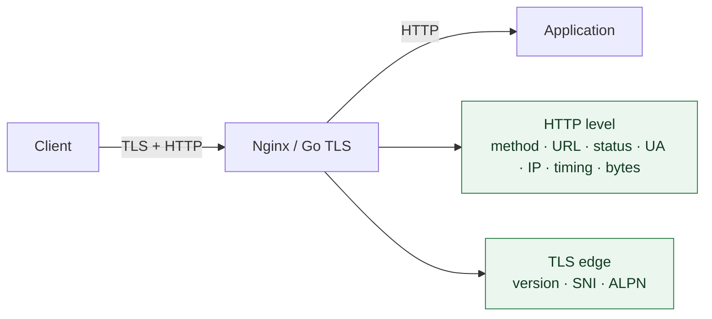

# httpfin: see what actually reached your API

[](go.mod)
[](Dockerfile)
[](Dockerfile)
[](docker-compose.yml)
[](https://github.com/rbelshevitz/httpfin/actions/workflows/ci.yml)

> **The test passed. The API disagreed. See what actually arrived.**

`httpfin` is a small diagnostic station for an API edge. Put it beside the
entry point, send the same request from different clients, and see what the
edge actually received: client, User-Agent, route, status, timing, HTTP
protocol, and the TLS fields visible at that point.

It turns “works in the browser, fails in the SDK” into a short comparison
instead of a long argument. Compare browsers, SDKs, proxies, ingress changes,
and reference traffic from `curl-impersonate` at the same observation point.

## What httpfin can see



The shown levels are available in the current product.

For most QA and API-client tests, the current HTTP observations plus the TLS
edge fields are sufficient: request, client, User-Agent, profile, status,
timing, bytes, TLS version, SNI, ALPN, and protocol.

## Why it is useful

When an API behaves unexpectedly, the response body is only half the story.
`httpfin` puts the request on the bench: who sent it, where it went, which
User-Agent it declared, what profile was inferred, which TLS signals were
visible, and what changed from the previous request.

That helps separate an API bug from a browser, SDK, proxy, TLS, or Nginx
change. The same observation is available as JSON, a compact UI, and a report
that QA, developers, and DevOps can attach to an investigation.

## Do you need the Nginx module?

Use the module when Nginx is the entry point that terminates TLS and proxies
traffic to the application. It sends each completed request to the Go
collector, including the client address, URL, User-Agent, status, timing,
response size, protocol, TLS version, SNI, and ALPN when available.

The module is not required when `httpfin` itself receives the traffic:

- `go-http` — direct HTTP observation on port `8080`;
- `go-tls` — direct HTTPS observation with TLS and SNI/ALPN fields;
- Nginx termination — Nginx module plus the Go collector.

Choose the first two modes for a local client test or a dedicated diagnostic
listener. Choose the Nginx mode to observe the traffic that actually enters an
existing Nginx-based API edge.

## Quick start: useful deployment

Send application traffic through Nginx with the `httpfin` module enabled. Nginx
remains the data-plane proxy; the Go collector receives observations and serves
the UI and reports.

In the first terminal, start the collector on a private address:

```bash
httpfin_addr=127.0.0.1:8080 \
httpfin_socket=/run/httpfin/events.sock \
go run ./cmd/httpfin
```

Before starting it, create `/run/httpfin` and grant the Nginx worker access to
the socket. Ready-to-use systemd unit and environment files are in
`deploy/systemd/`; the operating-modes guide covers the permission details.

In Nginx, point the module at the same Unix socket and enable it on the server
or location that proxies requests to your application:

```nginx
httpfin_socket /run/httpfin/events.sock;

server {
    listen 443 ssl;
    server_name api.example.test;

    ssl_certificate     /etc/nginx/tls/api.example.test.fullchain.pem;
    ssl_certificate_key /etc/nginx/tls/api.example.test.key;

    httpfin on;
    location / {
        proxy_pass http://your_application;
    }
}
```

For a local smoke test, create a self-signed certificate and map the example
hostname to localhost:

```bash
sudo install -d -m 0750 /etc/nginx/tls
sudo openssl req -x509 -nodes -newkey rsa:2048 -days 7 \
  -keyout /etc/nginx/tls/api.example.test.key \
  -out /etc/nginx/tls/api.example.test.fullchain.pem \
  -subj '/CN=api.example.test' \
  -addext 'subjectAltName=DNS:api.example.test'
echo '127.0.0.1 api.example.test' | sudo tee -a /etc/hosts
sudo nginx -t && sudo systemctl reload nginx
curl -kfsS https://api.example.test/health
```

The `-k` option is only for this local self-signed certificate. For a real
hostname, use a trusted certificate, for example with Certbot:

```bash
sudo certbot --nginx -d api.example.com
```

Certbot normally places the files under
`/etc/letsencrypt/live/api.example.com/`; point `ssl_certificate` and
`ssl_certificate_key` there, or copy/mount them to the paths above. Never use a
self-signed certificate in production.

See [`docs/OPERATING_MODES.md`](docs/OPERATING_MODES.md) for module
installation, socket permissions, and TLS configuration.

Now send a request through the application's entry point:

```bash
curl -fsS https://api.example.test/health \
  -H 'User-Agent: QA-client/1.0'
```

Verify that the request reached the collector and save reports:

```bash
curl -fsS http://127.0.0.1:8080/healthz
curl -fsS http://127.0.0.1:8080/api/ingest
curl -fsS http://127.0.0.1:8080/api/connections
curl -fsS http://127.0.0.1:8080/api/report > httpfin-report.txt
curl -fsS http://127.0.0.1:8080/report > httpfin-report.html
```

Open the status dashboard on port `8080` at <http://127.0.0.1:8080/>. The
standalone HTML snapshot is available at <http://127.0.0.1:8080/report>, the
aggregated snapshot at `/api/snapshot`, and live events at `/events` (SSE).
The dashboard shows recent observations, the detection point, transport
evidence, and details for the selected record.

`/api/ingest` exposes the Nginx-to-Go pipeline counters. `received` is the
number of datagrams read, `decoded` is valid JSON, `stored` reached the
collector store, and `dropped` was rejected as malformed or invalid. These
counters describe telemetry delivery.

By default the collector listens only on `127.0.0.1:8080` and keeps a bounded
number of recent observations in memory.
Synthetic demo records are enabled only with `httpfin_demo=1`.

### Direct local mode

To inspect HTTP/TLS fields without Nginx or a real application, run `httpfin`
as a standalone Go listener. This is a local diagnostic mode, not production
traffic proxying:

```bash
go run ./cmd/httpfin
curl -v http://127.0.0.1:8080/healthz
```

## Main deployment

```text
client -- TLS --> Nginx -- HTTP --> API
                    │
                    └─ httpfin module → Go collector → report/API
```

In the recommended mode, Nginx terminates TLS and exposes the HTTP request,
negotiated TLS version, SNI, and ALPN to the module. The module sends one
bounded, non-blocking event to Go over a Unix datagram socket. If the collector
is unavailable, Nginx continues serving requests, but the event may be lost.

Reports are generated when `/api/report` is requested. The service does not
write a report file; save the response by redirecting command output.

## What the current httpfin provides

- HTTP method, target, status, and source address;
- User-Agent and a heuristic client profile;
- TLS version, SNI, and ALPN when available at the observation point;
- changes between sequential observations;
- a JSON API, UI, and text report.

In direct Go mode, timing and response size are stored in the observation. The
Nginx module also sends request time, response size, and server protocol when
those variables are available.

## Important limits

The available fields depend on the observation point. An empty field means
“not observed at this point”, not that the client is invalid.

### Nginx HTTP module

After TLS termination, the module sees Nginx request-level data: method, URI,
User-Agent, source address, final HTTP status, negotiated TLS version, SNI,
and ALPN. It also sends request time, response size, and server protocol. The
event goes to Go after request processing through a non-blocking Unix datagram.

Response headers are not part of the current event schema.

Timing and response size are normalized into `elapsed_ms` and `bytes` when the
Nginx variables are available; missing values remain zero.

### Direct Go TLS

When `httpfin` terminates HTTPS itself, it additionally records the negotiated
TLS version, SNI, selected ALPN, and the client's offered ALPN list. In this
mode httpfin also measures response time and size.

### TLS passthrough

With TLS passthrough, Nginx does not terminate TLS and only forwards the
encrypted stream. The httpfin HTTP module cannot see the URL, headers,
User-Agent, or response status in that path. `ssl_preread` can expose SNI,
offered ALPN, and the advertised TLS version to Nginx for routing, but the
current httpfin version does not ingest those stream fields as a full
observation.

User-Agent and the profile inferred from it are client-declared or heuristic
signals and can be spoofed. TLS fields describe what reached the selected
termination point; they do not prove client identity. Reports are for
diagnostics, not authentication or blocking.

## Docker

The Docker image is a **demo/smoke image**. It contains Nginx, httpfin, and a
small mock API. It is not a production backend and does not connect to your
business application.

Nginx accepts HTTPS on `8443`, sends events to Go over a Unix socket, and
proxies `/app/` requests to the built-in mock API at `127.0.0.1:9000`. The
httpfin status dashboard and API remain available on the other routes.

This verifies TLS termination, the Nginx module, event delivery, an application
request, and reporting. Try it immediately after startup:

```bash
curl -k --resolve inspector.example.test:8443:127.0.0.1 \
  https://inspector.example.test:8443/app/api/catalog
curl -k --resolve inspector.example.test:8443:127.0.0.1 -X POST \
  https://inspector.example.test:8443/app/login
```

To observe a real application, replace `proxy_pass` in the Nginx configuration
with the API upstream and keep a separate route to the collector for the status
dashboard and reports.

In the Docker smoke setup, Nginx exposes the status dashboard and API over
HTTPS on port `8443` at
<https://inspector.example.test:8443/>. The direct collector dashboard uses
port `8080` instead.

```bash
docker compose up --build
curl -k --resolve inspector.example.test:8443:127.0.0.1 \
  https://inspector.example.test:8443/healthz
curl -k --resolve inspector.example.test:8443:127.0.0.1 \
  https://inspector.example.test:8443/api/report > httpfin-report.txt
```

Without the Compose plugin:

```bash
docker build --pull=false -t httpfin:local .
docker run -d --rm --name httpfin -p 8443:8443 httpfin:local
curl -k --resolve inspector.example.test:8443:127.0.0.1 \
  https://inspector.example.test:8443/healthz
curl -k --resolve inspector.example.test:8443:127.0.0.1 \
  https://inspector.example.test:8443/api/report > httpfin-report.txt
docker rm -f httpfin
```

The image creates a temporary self-signed certificate for testing only. In
production, provide the real certificate and key to Nginx as read-only secrets.
If Alpine cannot download packages because of DNS, retry the build with
`--network=host`.

## Documentation

- [`docs/USE_CASES.md`](docs/USE_CASES.md) — practical workflows for API, QA, and operations;
- [`docs/OPERATING_MODES.md`](docs/OPERATING_MODES.md) — TLS, certificates, and Nginx modes;
- [`docs/INTEGRATION_FORMAT.md`](docs/INTEGRATION_FORMAT.md) — module events and report format;
- [`docs/DEVOPS_RUNBOOK.md`](docs/DEVOPS_RUNBOOK.md) — operational troubleshooting;
- [`docs/OBSERVATION_SEMANTICS.md`](docs/OBSERVATION_SEMANTICS.md) — semantics of observed HTTP and transport evidence;
- [`docs/SECURITY_AUDIT.md`](docs/SECURITY_AUDIT.md) — security and reliability audit;
- [`TODO.md`](TODO.md) — current work plan.

## Development checks

```bash
go test ./...
go vet ./...
./tests/nginx-module-static.sh
./tests/container-smoke.sh
```

The full Docker/Nginx module build is available manually through the GitHub
Actions workflow `Manual Docker build`. Fast CI checks the Go code and module
source.

Russian documentation: [`README.ru.md`](README.ru.md).
