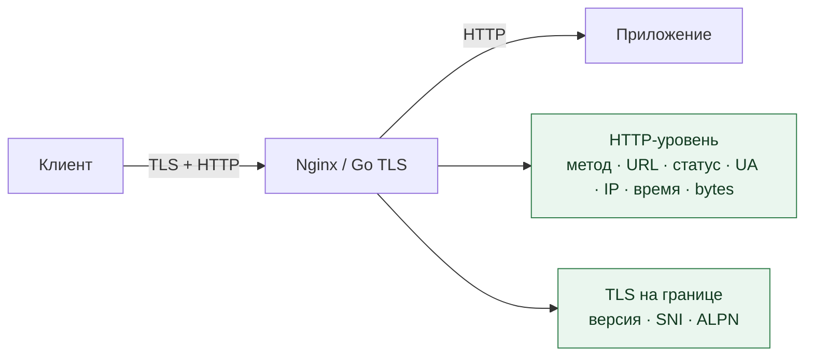

# httpfin: что на самом деле дошло до API

[](go.mod)
[](Dockerfile)
[](Dockerfile)
[](docker-compose.yml)
[](https://github.com/rbelshevitz/httpfin/actions/workflows/ci.yml)

> **Тест говорит одно. API увидел другое. Посмотрим, что пришло на самом деле.**

`httpfin` — небольшой диагностический прибор на границе API. Поставьте его рядом
с входной точкой, отправьте один и тот же запрос разными клиентами и посмотрите,
что реально получил edge: кто пришёл, какой User-Agent назвал себя, куда пошёл
запрос, какой был статус, сколько он длился и какие HTTP/TLS-признаки видны в
этой точке.

Фраза «в браузере работает, а SDK падает» превращается в короткое сравнение, а
не в длинный спор. Сравнивайте браузеры, SDK, прокси, изменения ingress и
эталонный трафик `curl-impersonate` в одной точке наблюдения.

## Что видит httpfin



Показанные уровни уже доступны в текущем продукте.

Для большинства QA- и API-тестов достаточно текущих HTTP-наблюдений и полей TLS
на границе: запрос, клиент, User-Agent, профиль, статус, время, bytes, версия
TLS, SNI, ALPN и протокол.

## Зачем она нужна?

Когда API отвечает неожиданно, тело ответа рассказывает только половину истории.
`httpfin` кладёт запрос на диагностический стенд: кто его отправил, куда он
пошёл, какой User-Agent указал клиент, какой профиль определился, какие TLS-
признаки были видны и что изменилось по сравнению с прошлым запросом.

Так проще отделить ошибку API от изменения браузера, SDK, прокси, TLS или
настройки Nginx. Одно и то же наблюдение доступно в JSON, компактном UI и
отчёте, который можно приложить к расследованию QA, разработчика или DevOps.

## Нужен ли модуль Nginx?

Модуль нужен, когда Nginx принимает трафик на входе, завершает TLS и
проксирует запросы в приложение. Он передаёт Go-сборщику каждое завершённое
наблюдение: исходный адрес, который видит Nginx, URL, User-Agent, статус,
время, размер ответа, протокол, версию TLS, SNI и ALPN, если они доступны.

Модуль не нужен, если трафик принимает сам `httpfin`:

- `go-http` — прямое наблюдение HTTP на порту `8080`;
- `go-tls` — прямое HTTPS-наблюдение с полями TLS, SNI и ALPN;
- Nginx termination — модуль Nginx и Go-сборщик вместе.

Первые два режима подходят для локального теста клиента или отдельного
диагностического слушателя. Режим с Nginx нужен, чтобы увидеть трафик, который
реально входит в существующую API-входную точку на Nginx.

## Быстрый запуск: рабочий режим

Направьте трафик приложения через Nginx с включённым модулем `httpfin`. Nginx
обслуживает трафик, а Go-сборщик получает наблюдения и отдаёт UI и отчёты.

В первом терминале запустите сборщик на локальном адресе:

```bash
httpfin_addr=127.0.0.1:8080 \
httpfin_socket=/run/httpfin/events.sock \
go run ./cmd/httpfin
```

Перед этим создайте `/run/httpfin` и дайте пользователю Nginx доступ к сокету.
Для systemd готовые unit и env-файл находятся в `deploy/systemd/`; подробности
прав доступа приведены в документации по режимам работы.

В Nginx задайте тот же Unix-сокет и включите модуль в блоке `server` или
`location`, который проксирует запросы в ваше приложение:

```nginx
httpfin_socket /run/httpfin/events.sock;

server {
    listen 443 ssl;
    server_name api.example.test;

    ssl_certificate     /etc/nginx/tls/api.example.test.fullchain.pem;
    ssl_certificate_key /etc/nginx/tls/api.example.test.key;

    httpfin on;
    location / {
        proxy_pass http://your_application;
    }
}
```

Для локального smoke-теста создайте самоподписанный сертификат и направьте
примерное имя хоста на localhost:

```bash
sudo install -d -m 0750 /etc/nginx/tls
sudo openssl req -x509 -nodes -newkey rsa:2048 -days 7 \
  -keyout /etc/nginx/tls/api.example.test.key \
  -out /etc/nginx/tls/api.example.test.fullchain.pem \
  -subj '/CN=api.example.test' \
  -addext 'subjectAltName=DNS:api.example.test'
echo '127.0.0.1 api.example.test' | sudo tee -a /etc/hosts
sudo nginx -t && sudo systemctl reload nginx
curl -kfsS https://api.example.test/health
```

Опция `-k` нужна только для этого локального самоподписанного сертификата. Для
реального имени используйте доверенный сертификат, например через Certbot:

```bash
sudo certbot --nginx -d api.example.com
```

Обычно Certbot создаёт файлы в
`/etc/letsencrypt/live/api.example.com/`; укажите эти пути в
`ssl_certificate` и `ssl_certificate_key` либо смонтируйте сертификаты в пути
из примера. Самоподписанный сертификат нельзя использовать в production.

Полная установка модуля, права на сокет и TLS-конфигурация описаны в
[`docs/OPERATING_MODES.ru.md`](docs/OPERATING_MODES.ru.md).

Теперь отправьте запрос именно через входную точку приложения:

```bash
curl -fsS https://api.example.test/health \
  -H 'User-Agent: QA-client/1.0'
```

Проверьте, что запрос попал в сборщик, и откройте status-dashboard:

```bash
curl -fsS http://127.0.0.1:8080/healthz
curl -fsS http://127.0.0.1:8080/api/ingest
curl -fsS http://127.0.0.1:8080/api/connections
curl -fsS http://127.0.0.1:8080/api/report > httpfin-report.txt
curl -fsS http://127.0.0.1:8080/report > httpfin-report.html
```

В браузере откройте веб-интерфейс status-dashboard на порту `8080`:
<http://127.0.0.1:8080/>. HTML snapshot-отчёт — по адресу
<http://127.0.0.1:8080/report>, агрегированный snapshot — через
`/api/snapshot`, а live-события — через `/events` (SSE). В status-dashboard
отображаются последние наблюдения, источник детектирования, transport evidence
и подробности выбранной записи.

`/api/ingest` показывает счётчики конвейера Nginx → Go. `received` — прочитанные
датаграммы, `decoded` — корректный JSON, `stored` — события, переданные в
хранилище, `dropped` — отброшенные из-за ошибки JSON или проверки события.
Это показатели доставки телеметрии, а не риска или качества клиентских
запросов.

По умолчанию сервис слушает только `127.0.0.1:8080` и хранит ограниченное
число последних наблюдений в памяти. Другой адрес и порт задаются переменной
`httpfin_addr`, например `httpfin_addr=127.0.0.1:18080`. Демонстрационные
записи включаются только через `httpfin_demo=1`.

### Прямой локальный режим

Если нужно проверить только HTTP/TLS-поля без Nginx и реального приложения,
`httpfin` можно запустить как самостоятельный Go listener. Это режим локальной
диагностики, а не проксирование production-трафика:

```bash
go run ./cmd/httpfin
curl -v http://127.0.0.1:8080/healthz
```

## Основной режим

```text
клиент -- TLS --> Nginx -- HTTP --> API
                    │
                    └─ модуль httpfin → Go-сборщик → отчёт/API
```

В рекомендуемом режиме Nginx завершает TLS. Модуль получает HTTP-данные,
версию TLS, SNI и ALPN, а затем отправляет ограниченное
неблокирующее событие в Go через Unix-датаграмму. Если сборщик недоступен, Nginx
продолжает обслуживать запросы, но событие может потеряться.

Отчёт создаётся при запросе к `/api/report` и не записывается сервисом в файл.
Сохранить его можно перенаправлением вывода, как в примере выше.

## Что показывает текущий httpfin

- метод HTTP, путь, статус и исходный IP-адрес;
- User-Agent и эвристический профиль клиента;
- TLS-версию, SNI и ALPN, если они доступны в точке наблюдения;
- изменения признаков между последовательными наблюдениями;
- JSON API, UI и текстовый отчёт.

В прямом Go-режиме время обработки и размер ответа попадают в запись. Модуль
Nginx также передаёт время запроса, размер ответа и протокол, если эти
переменные доступны.

## Важные ограничения

Набор полей зависит от точки наблюдения. Пустое поле означает «в этой точке не
наблюдалось», а не ошибку клиента.

### Nginx HTTP-модуль

После завершения TLS модуль видит данные запроса из Nginx: метод, URI,
User-Agent, исходный адрес, итоговый HTTP-статус, согласованную версию TLS,
SNI и ALPN. Он также передаёт время запроса, размер ответа и протокол.
Событие отправляется в Go после обработки запроса через неблокирующую
Unix-датаграмму.

На HTTP-фазе Nginx исходный `ClientHello` уже недоступен. Отсюда следуют две
жёсткие границы текущего модуля:

- стандартные JA3/JA4 и connection-level fingerprint HTTP/2 не собираются
  встроенным Nginx request-level путём;

Заголовки ответа — отдельное достижимое расширение. Nginx может их наблюдать,
но текущая схема события их пока не содержит. Добавление заголовков расширит
контракт модуля и не потребует реализации JA3/JA4.

Время и размер ответа нормализуются в `elapsed_ms` и `bytes`, если переменные
Nginx доступны. Если значение не удалось получить, поле остаётся равным нулю.

### Прямой Go TLS

Если `httpfin` сам завершает HTTPS, он дополнительно получает согласованную
версию TLS, SNI и выбранный ALPN, список предложенных клиентом ALPN, а также
собственную локальную `ClientHello`-подпись. Эта подпись — внутренний SHA-256,
рассчитанный по выбранным полям `ClientHelloInfo` в Go; это не стандартный JA3
или JA4. В этом режиме httpfin
также измеряет время и размер ответа.

### TLS passthrough

При TLS passthrough Nginx не завершает TLS, а только пересылает зашифрованный
поток. HTTP-модуль httpfin в такой цепочке не видит URL, заголовки,
User-Agent и статус ответа. `ssl_preread` может дать самому Nginx SNI,
предложенный ALPN и заявленную версию TLS для маршрутизации, но текущая версия
httpfin не принимает эти поля потокового режима как полноценное наблюдение.

User-Agent и определённый по нему профиль являются заявленными или
эвристическими признаками и могут быть подделаны. TLS-поля показывают то, что
дошло до выбранной точки завершения TLS; они не доказывают личность клиента.
Отчёт предназначен для диагностики, а не для аутентификации или блокировки.

## Docker

Docker-образ — **demo/smoke-образ**. Он содержит Nginx, сам httpfin и маленькое
демонстрационное mock API. Это не production backend и не подключение к вашему
бизнес-приложению.

Nginx принимает HTTPS на `8443`, отправляет событие в Go через Unix-сокет и
проксирует запросы `/app/` во встроенное mock API на `127.0.0.1:9000`. Сам
status-dashboard и API httpfin доступны через остальные маршруты.

Так проверяются TLS termination, Nginx-модуль, доставка события, запрос к
приложению и отчёт. Для проверки сразу после запуска выполните:

```bash
curl -k --resolve inspector.example.test:8443:127.0.0.1 \
  https://inspector.example.test:8443/app/api/catalog
curl -k --resolve inspector.example.test:8443:127.0.0.1 -X POST \
  https://inspector.example.test:8443/app/login
```

Чтобы наблюдать настоящее приложение, замените `proxy_pass` в Nginx-конфигурации
на адрес API и оставьте отдельный маршрут к collector для status-dashboard и
отчётов.

```bash
docker compose up --build
curl -k --resolve inspector.example.test:8443:127.0.0.1 \
  https://inspector.example.test:8443/healthz
curl -k --resolve inspector.example.test:8443:127.0.0.1 \
  https://inspector.example.test:8443/api/report > httpfin-report.txt
```

Без Compose-плагина:

```bash
docker build --pull=false -t httpfin:local .
docker run -d --rm --name httpfin -p 8443:8443 httpfin:local
curl -k --resolve inspector.example.test:8443:127.0.0.1 \
  https://inspector.example.test:8443/healthz
curl -k --resolve inspector.example.test:8443:127.0.0.1 \
  https://inspector.example.test:8443/api/report > httpfin-report.txt
docker rm -f httpfin
```

Образ создаёт временный самоподписанный сертификат только для проверки. В рабочей
среде сертификат и ключ нужно передавать Nginx как секреты только для чтения.
Если Alpine не может скачать пакеты из-за DNS, повторите сборку с
`--network=host`.

## Документация

- [`docs/USE_CASES.ru.md`](docs/USE_CASES.ru.md) — практические сценарии для API, QA и эксплуатации;
- [`docs/OPERATING_MODES.ru.md`](docs/OPERATING_MODES.ru.md) — TLS, сертификаты и режимы Nginx;
- [`docs/INTEGRATION_FORMAT.ru.md`](docs/INTEGRATION_FORMAT.ru.md) — событие модуля и формат отчёта;
- [`docs/DEVOPS_RUNBOOK.ru.md`](docs/DEVOPS_RUNBOOK.ru.md) — эксплуатационная диагностика;
- [`docs/OBSERVATION_SEMANTICS.ru.md`](docs/OBSERVATION_SEMANTICS.ru.md) — семантика наблюдаемых HTTP- и транспортных признаков;
- [`docs/SECURITY_AUDIT.ru.md`](docs/SECURITY_AUDIT.ru.md) — аудит безопасности и надёжности;
- [`TODO.ru.md`](TODO.ru.md) — текущий план работ.

## Проверки разработки

```bash
go test ./...
go vet ./...
./tests/nginx-module-static.sh
./tests/container-smoke.sh
```

Полная сборка Docker/Nginx-модуля запускается вручную через GitHub Actions
workflow `Manual Docker build`. Быстрый CI проверяет Go-код и исходник модуля.

English documentation: [`README.md`](README.md).
