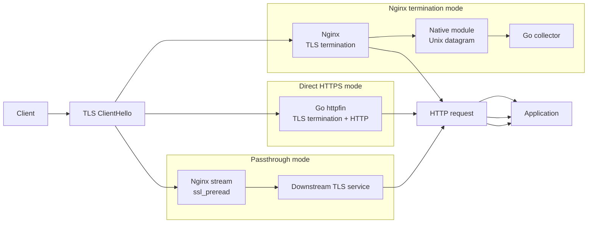
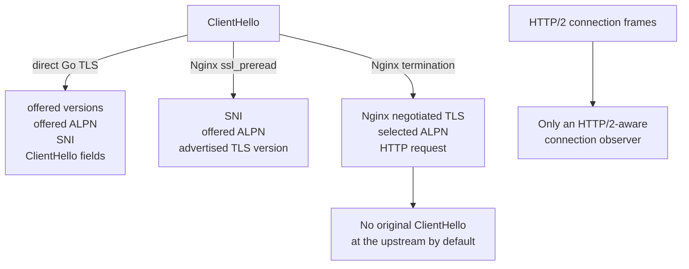
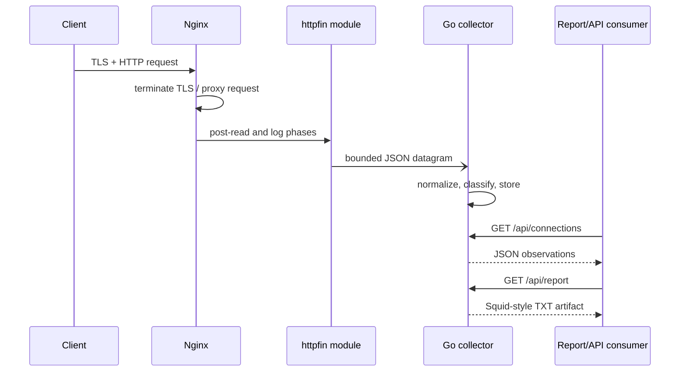
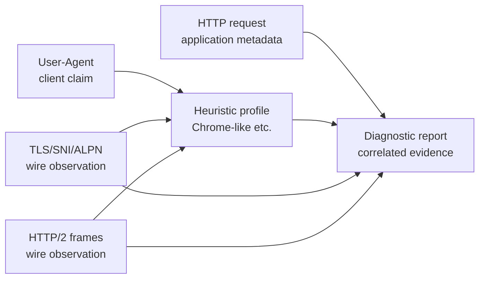

# httpfin architecture and observation boundaries

The diagrams below show what is measured at each deployment point. They are
deliberately explicit about the difference between client offers, negotiated
values, and HTTP data visible after TLS termination.

## Deployment modes

## What each mode can observe

`ssl_preread` values describe the ClientHello. They are not the downstream
connection's negotiated result. In a terminating TLS endpoint, the negotiated
version and selected ALPN can be recorded after the handshake.

## Event and report pipeline

The native module is active only inside Nginx's HTTP request lifecycle:

1. Nginx completes or rejects the TLS handshake before the HTTP module sees a
   request. The module does not parse raw ClientHello.
2. In `NGX_HTTP_POST_READ_PHASE`, after request headers are read, it allocates
   the request ID and enables per-request context when `httpfin on;` applies.
3. Nginx proxies or serves the request normally.
4. In `NGX_HTTP_LOG_PHASE`, after the request has a final status, the module
   copies bounded HTTP/TLS variables and sends one Unix datagram to Go.

The module is therefore a request-to-collector handoff at the HTTP layer, not
a TLS preread module, proxy, or policy engine. `ngx_stream_ssl_preread_module`
is a separate Nginx stream module used for passthrough SNI/ALPN routing.

The datagram is best-effort telemetry. Access logs remain the operational
fallback when a collector socket is unavailable or under backpressure.

## Evidence model

The profile is an inference. JA3 and JA4 are fingerprinting formats, not
authentication mechanisms; a fingerprint can be shared by different clients,
changed by a proxy, or deliberately imitated.

## What `JA*` means

| Name | Meaning | Input | Status in httpfin |
|---|---|---|---|
| JA3 | TLS client fingerprint | normalized ClientHello version, cipher suites, extensions, supported groups and point formats, then an MD5 digest | not computed by the current Nginx HTTP module |
| JA3S | TLS server-response fingerprint | selected fields from the ServerHello response | not collected |
| JA4 | newer TLS client fingerprint in the FoxIO JA4+ family | ClientHello-derived, normalized into a readable three-part value | requires a raw TLS observer and an implementation |
| JA4H | HTTP client fingerprint in JA4+ | HTTP request behavior and headers | requires an HTTP-aware collector; not inferred from one handoff event |
| JA4+ | family name | TLS, HTTP, TCP, X.509, SSH and other methods such as JA4, JA4H, JA4T and JA4X | reference terminology only |

JA3 is a method for grouping similar TLS handshakes, not a browser identity.
JA4 is not an RFC-defined protocol field; it is a separate fingerprinting
method. Exact values require the corresponding raw traffic and the same
algorithm/version as the reference implementation. `httpfin` currently keeps
JA3/JA4/HTTP2 fields empty unless an external observer supplies them.

## Scientific basis

- [RFC 9846 — TLS 1.3](https://www.rfc-editor.org/rfc/rfc9846) defines the
  current TLS 1.3 specification and updates RFC 8446;
- [RFC 6066 — SNI](https://www.rfc-editor.org/rfc/rfc6066) defines the
  `server_name` ClientHello extension;
- [RFC 7301 — ALPN](https://www.rfc-editor.org/rfc/rfc7301) defines client
  protocol offers and server protocol selection;
- [RFC 9113 — HTTP/2](https://www.rfc-editor.org/rfc/rfc9113) defines the
  connection preface, SETTINGS and binary frames;
- [RFC 9110 — HTTP semantics](https://www.rfc-editor.org/rfc/rfc9110) defines
  methods, targets, status codes and message fields;
- [Nginx SSL preread](https://nginx.org/en/docs/stream/ngx_stream_ssl_preread_module.html)
  documents the fields Nginx can extract without terminating TLS;
- [JA3 reference](https://github.com/salesforce/ja3) describes the TLS
  ClientHello fingerprint format and is now archived;
- [JA4+ reference](https://github.com/FoxIO-LLC/ja4) documents the current
  JA4+ family maintained by FoxIO.
- [RFC 8446 — original TLS 1.3](https://www.rfc-editor.org/rfc/rfc8446)
  remains a useful historical reference; it is obsoleted by RFC 9846;
- [RFC 9849 — Encrypted ClientHello](https://www.rfc-editor.org/rfc/rfc9849)
  explains why the visible outer SNI may not be the client's true destination;
- [RFC 7239 — Forwarded](https://www.rfc-editor.org/rfc/rfc7239) defines the
  standardized proxy-forwarding field used for identity propagation.
