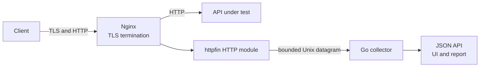
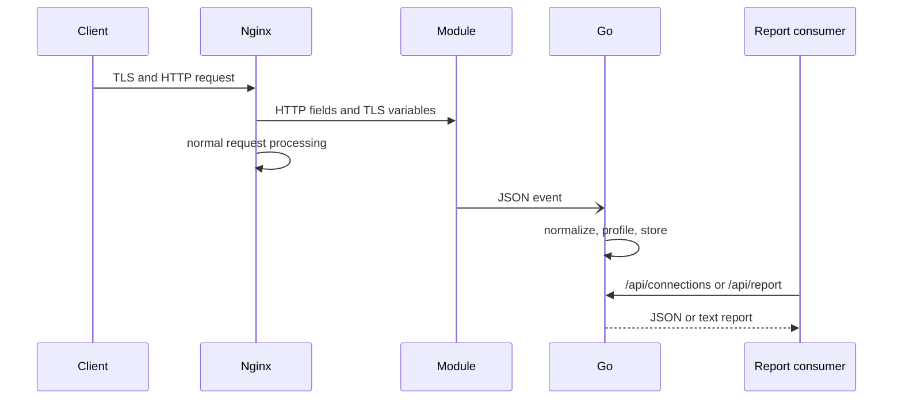

# How httpfin works

`httpfin` sits in front of an API so the team can see client requests. It does
not change requests or block clients. The usual production mode is Nginx TLS
termination with short request records sent to `httpfin`.

## Main flow



Nginx keeps serving the request even when the collector is unavailable. Go keeps
recent records in memory, reads the User-Agent, and builds the report.

## Where TLS terminates

| Mode | Who handles HTTPS | What `httpfin` sees | What it cannot see |
|---|---|---|---|
| Nginx termination | Nginx | HTTP, User-Agent, status, IP, TLS, SNI, and ALPN | original ClientHello, exact JA3/JA4, and HTTP/2 SETTINGS |
| Direct HTTPS | Go/httpfin | HTTP, TLS, SNI, ALPN, and selected ClientHello fields | standard JA3/JA4 without a separate calculation step |
| TLS passthrough | downstream service | no HTTP request reaches `httpfin` | URL, headers, User-Agent, and status |

In passthrough, Nginx can read SNI, offered ALPN, and the advertised TLS version
to choose a server. This is a separate Nginx stream module, not the `httpfin`
HTTP module.

`ClientHello` is the first TLS message sent by a client. After TLS termination it
is no longer available to the ordinary Nginx HTTP module. It cannot be rebuilt
from an HTTP request.

## What httpfin can see

| Signal | What the current `httpfin` provides | What it cannot provide |
|---|---|---|
| HTTP method and path | Yes, in the Nginx event and direct Go mode | Nothing material at this observation point |
| Response status | Yes, the final request status | Complete cross-checking without the access log |
| Source address | Yes, the address seen by the observation point | A trustworthy original address when proxy/real-IP handling is wrong |
| User-Agent | Yes, the declared value | Proof that it was not spoofed |
| Client profile | Yes, a rough User-Agent profile; a reference can be compared | Reliable browser or bot classification |
| TLS version, SNI, ALPN | Yes, when TLS terminates in Nginx or Go | These fields in plain HTTP and some data in passthrough |
| Request timing and response size | Yes, in direct Go mode or the Nginx access log | In the current Nginx HTTP-module event |
| Selected ClientHello fields | Yes, only in direct Go TLS mode | In the Nginx HTTP module after TLS termination |
| Standard JA3 and JA4 | No, the current project does not calculate them | A separate TLS observer or supplied values |
| HTTP/2 SETTINGS and frame order | No | An HTTP/2 connection-level observer |

An empty value means that the selected observation point did not provide the
signal. It does not mean that the client mismatched.

## System parts

```text
Nginx worker
  └─ ngx_http_httpfin_module.so
       └─ Unix datagram, no delivery guarantee
            └─ /run/httpfin/events.sock
                 └─ Go httpfin
                      ├─ normalization and profiling
                      ├─ bounded in-memory store
                      └─ /api/connections, /api/report, and UI
```

Nginx loads the module with `load_module`. The module runs only while Nginx is
processing an HTTP request:

1. a request ID is created when `httpfin on;` applies;
2. Nginx serves or forwards the request;
3. after the response, the module collects the needed fields;
4. the record is sent to Go without waiting for a reply.

If the Unix socket is unavailable or full, the record may be lost. The client
request still continues. Keep the Nginx access log when every request must be
accounted for.

## Data flow



The module record contains request ID, method, URI, User-Agent, source address,
status, TLS version, SNI, and ALPN. Request timing and response size come from
direct Go mode or the Nginx access log; the current module does not include them.

The client profile is a User-Agent heuristic. It does not prove a browser type,
client identity, or bot status.

## Project boundaries

- the JSON API and text report use the current in-memory store;
- observations are lost after a restart;
- standard JA3/JA4 are not calculated by the current HTTP module;
- connection-level HTTP/2 is not analyzed;
- TLS passthrough does not provide HTTP data to `httpfin`;
- the module does not identify clients, block requests, or control the firewall.

See [`OPERATING_MODES.md`](OPERATING_MODES.md) for compatibility, certificates,
and deployment modes. See [`INTEGRATION_FORMAT.md`](INTEGRATION_FORMAT.md) for
the event and report format. See [`WIRE_OBSERVER.md`](WIRE_OBSERVER.md) for the
ClientHello and HTTP/2 observation limits.
