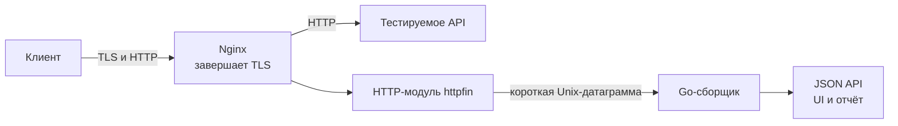
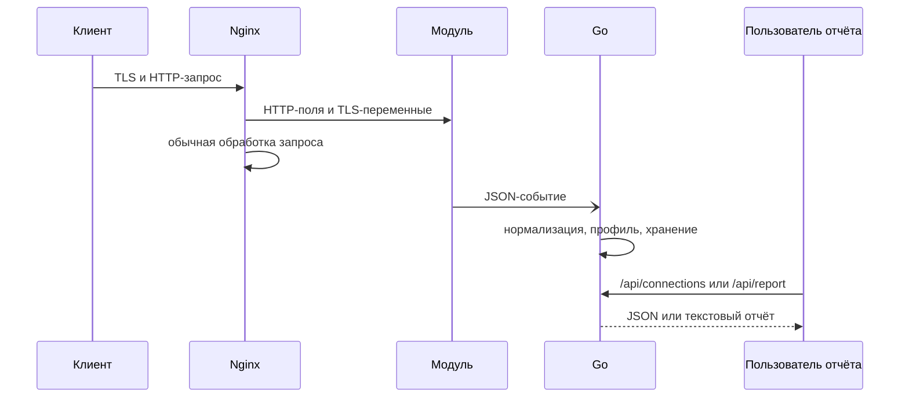

# Как устроен httpfin

`httpfin` ставят перед API, чтобы видеть запросы клиентов. Он не меняет запросы
и ничего не блокирует. Обычно Nginx принимает HTTPS, а `httpfin` получает от
него короткие записи о запросах.

## Как проходит запрос



Nginx продолжает работать, даже если `httpfin` временно недоступен. Go хранит
последние записи в памяти, смотрит на User-Agent и строит отчёт.

## Где заканчивается TLS

| Режим | Кто принимает HTTPS | Что видит `httpfin` | Чего не видит |
|---|---|---|---|
| Nginx завершает TLS | Nginx | HTTP, User-Agent, статус, IP, TLS, SNI и ALPN | исходного ClientHello, точного JA3/JA4 и HTTP/2 SETTINGS |
| Прямой HTTPS | Go/httpfin | HTTP, TLS, SNI, ALPN и отдельные поля ClientHello | стандартных JA3/JA4 без отдельного расчёта |
| Сквозная передача TLS (`passthrough`) | конечный сервис | `httpfin` не видит HTTP-запрос | URL, заголовков, User-Agent и статуса |

При включённом `ssl_preread` Nginx может прочитать SNI и предложенный ALPN,
чтобы выбрать сервер. Это отдельный режим Nginx, не часть HTTP-модуля
`httpfin`.

`ClientHello` — первое сообщение TLS от клиента. После завершения TLS оно
теряется для обычного HTTP-модуля Nginx. Восстановить его из HTTP-запроса нельзя.

## Что именно видит httpfin

| Признак | Что видит текущий `httpfin` | Чего он не видит |
|---|---|---|
| Метод и путь | Да | — |
| Статус ответа | Да | Полную сверку с каждым запросом без журнала Nginx |
| IP-адрес | Да, тот, который видит Nginx | Настоящий адрес клиента при неверной настройке прокси |
| User-Agent | Да, как его назвал клиент | Проверку, что клиент не соврал |
| Профиль клиента | Да, примерный профиль по User-Agent | Надёжное определение браузера или бота |
| Версия TLS, SNI, ALPN | Да, если TLS заканчивается в Nginx или Go | Эти данные в обычном HTTP и при сквозной передаче TLS |
| Время и размер ответа | Да, в Go-режиме или журнале Nginx | В событии текущего Nginx-модуля |
| Поля ClientHello | Да, только в прямом Go TLS-режиме | После завершения TLS в HTTP-модуле Nginx |
| JA3 и JA4 | Нет | Нужна отдельная программа для чтения TLS |
| Настройки и кадры HTTP/2 | Нет | Нужна отдельная программа для наблюдения за HTTP/2 |

Пустое поле означает, что этот признак не удалось увидеть. Это не означает,
что клиент «не совпал».

## Из чего состоит система

```text
Nginx worker
  └─ ngx_http_httpfin_module.so
       └─ Unix-датаграмма без гарантии доставки
            └─ /run/httpfin/events.sock
                 └─ Go httpfin
                      ├─ нормализация и профиль
                      ├─ ограниченное хранилище в памяти
                      └─ /api/connections, /api/report и UI
```

Nginx загружает модуль через `load_module`. Модуль работает только во время
обработки HTTP-запроса:

1. в начале запроса создаётся ID, если включён `httpfin on;`;
2. Nginx обслуживает или передаёт запрос дальше;
3. после ответа модуль собирает нужные поля;
4. запись отправляется в Go через Unix-сокет и не ждёт ответа.

Если сокет недоступен или переполнен, запись может потеряться. Запрос клиента
при этом продолжает работать. Для полного учёта нужен журнал доступа Nginx.

## Какие данные проходят через систему



Запись модуля содержит ID, метод, URI, User-Agent, исходный адрес,
статус, TLS-версию, SNI, ALPN, протокол, время обработки и размер ответа.
Последние три значения нормализуются в записи, если Nginx их предоставил.

Профиль клиента — это примерная оценка по User-Agent. Он не доказывает тип
браузера, личность клиента или наличие бота.

## Чего проект не делает

- не хранит данные вне памяти;
- не сохраняет наблюдения после перезапуска;
- не считает стандартные JA3/JA4;
- не разбирает HTTP/2 на уровне соединения;
- не видит HTTP при сквозной передаче TLS;
- не проверяет личность, не блокирует запросы и не управляет межсетевым экраном.

Совместимость динамического модуля, сертификаты и режимы запуска описаны в
[`OPERATING_MODES.ru.md`](OPERATING_MODES.ru.md). Формат события и отчёта — в
[`INTEGRATION_FORMAT.ru.md`](INTEGRATION_FORMAT.ru.md). Подробные ограничения
анализа ClientHello и HTTP/2 — в [`WIRE_OBSERVER.ru.md`](WIRE_OBSERVER.ru.md).
