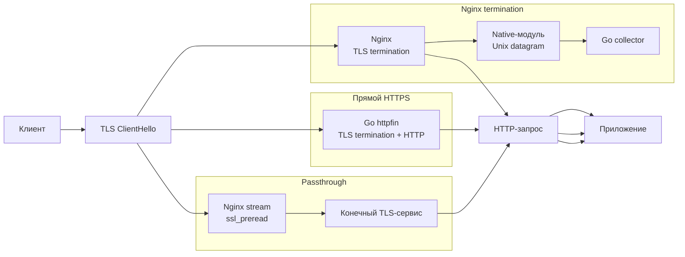
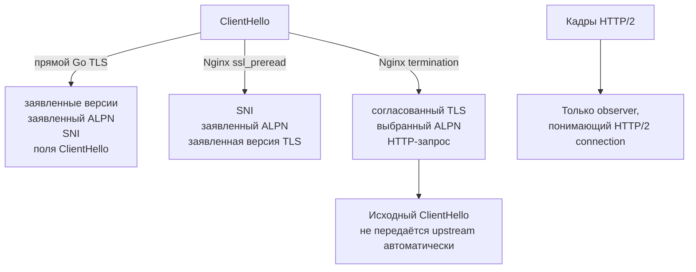
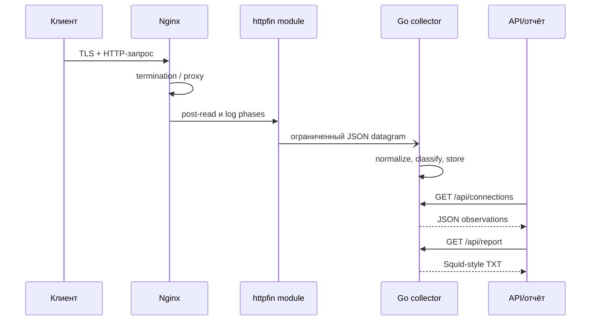
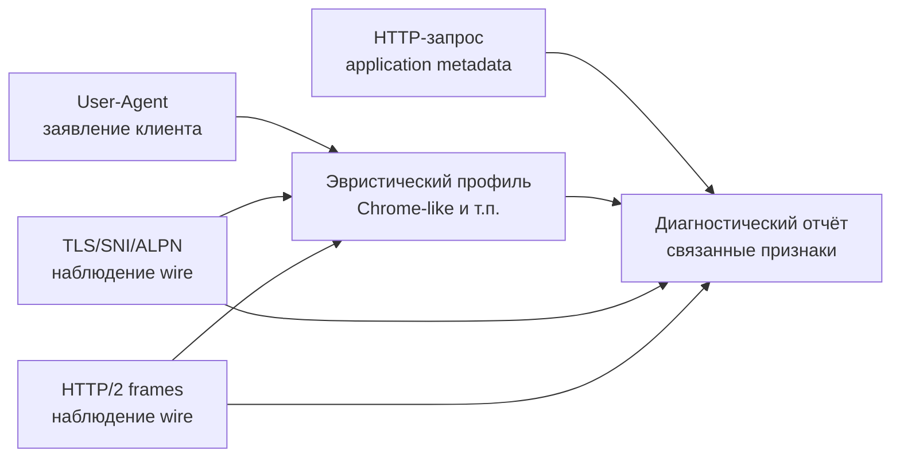

# Архитектура httpfin и границы наблюдения

Диаграммы показывают, какие данные доступны в каждом режиме. Важно разделять
заявленные клиентом параметры, согласованные значения и HTTP-данные после TLS
termination.

## Режимы развёртывания

## Что видно в каждом режиме

Значения `ssl_preread` описывают ClientHello. Это не результат переговоров с
конечным TLS-сервисом. Согласованные TLS version и ALPN доступны на endpoint,
который сам завершает TLS.

## Поток события и отчёта

Native-модуль работает только внутри HTTP-жизненного цикла Nginx:

1. Nginx сначала принимает или отклоняет TLS handshake. Только после этого
   HTTP-модуль видит запрос; raw ClientHello он не разбирает.
2. В `NGX_HTTP_POST_READ_PHASE`, после чтения headers, модуль создаёт request
   ID и включает контекст запроса, если действует `httpfin on;`.
3. Nginx штатно обслуживает запрос или проксирует его upstream.
4. В `NGX_HTTP_LOG_PHASE`, когда известен финальный status, модуль копирует
   ограниченный набор HTTP/TLS-полей и отправляет один Unix datagram в Go.

Итак, модуль — это handoff на HTTP-слое от запроса к collector. Это не TLS
preread-модуль, не proxy и не policy engine. Для passthrough SNI/ALPN используется
отдельный `ngx_stream_ssl_preread_module` Nginx.

## Матрица компонентов

| Развёртывание | Go-исполняемый файл | Native-модуль | Результат |
|---|---:|---:|---|
| Прямая отладка HTTP/HTTPS | да | нет | Go API, UI, отчёты и прямое TLS-наблюдение |
| Анализ access log Nginx | внешний collector по необходимости | нет | access log Nginx без handoff-модуля |
| Nginx termination и структурированный анализ httpfin | да | да | data-plane Nginx плюс Go API, UI и отчёты |
| Только passthrough-маршрутизация Nginx | нет | нет HTTP-модуля | SNI/ALPN preread и stream routing |

Go-исполняемый файл — не библиотека-помощник для `.so`, а consumer и
analysis-сервис. Native-модуль — адаптер, который делает request-данные Nginx
доступными этому сервису.

Datagram — best-effort telemetry. Access log остаётся операционным резервом при
недоступном сокете или backpressure.

## Модель свидетельств

Профиль является выводом, а не доказательством. JA3 и JA4 — форматы сетевого
fingerprinting, а не механизмы аутентификации: один fingerprint могут иметь
разные клиенты, его может изменить proxy, и его можно намеренно имитировать.

## Что означает `JA*`

| Имя | Смысл | Входные данные | Состояние в httpfin |
|---|---|---|---|
| JA3 | fingerprint TLS-клиента | нормализованные version, cipher suites, extensions, supported groups и point formats ClientHello, затем MD5 | текущий Nginx HTTP-модуль не считает |
| JA3S | fingerprint ответа TLS-сервера | выбранные поля ответа ServerHello | не собирается |
| JA4 | новый fingerprint TLS-клиента из семейства FoxIO JA4+ | данные ClientHello, нормализованные в читаемое значение из трёх частей | нужен raw TLS observer и отдельная реализация |
| JA4H | fingerprint HTTP-клиента в JA4+ | поведение HTTP-запроса и headers | нужен HTTP-aware collector; из одного handoff-события не выводится |
| JA4+ | название семейства | методы для TLS, HTTP, TCP, X.509, SSH и др.: JA4, JA4H, JA4T, JA4X | только справочная терминология |

JA3 группирует похожие TLS handshakes, но не удостоверяет браузер. JA4 не
является полем RFC, а отдельным методом fingerprinting. Для точного значения
нужны соответствующие raw-данные и та же версия алгоритма, что у reference
implementation. Сейчас `httpfin` оставляет JA3/JA4/HTTP2 пустыми, если их не
передал внешний observer.

## Техническая база

- [RFC 9846 — TLS 1.3](https://www.rfc-editor.org/rfc/rfc9846);
- [RFC 6066 — SNI](https://www.rfc-editor.org/rfc/rfc6066);
- [RFC 7301 — ALPN](https://www.rfc-editor.org/rfc/rfc7301);
- [RFC 9113 — HTTP/2](https://www.rfc-editor.org/rfc/rfc9113);
- [RFC 9110 — HTTP semantics](https://www.rfc-editor.org/rfc/rfc9110);
- [Nginx SSL preread](https://nginx.org/en/docs/stream/ngx_stream_ssl_preread_module.html);
- [JA3 reference](https://github.com/salesforce/ja3), архивированный upstream;
- [JA4+ reference](https://github.com/FoxIO-LLC/ja4), актуальный upstream FoxIO.
- [RFC 8446 — исходная спецификация TLS 1.3](https://www.rfc-editor.org/rfc/rfc8446),
  заменённая RFC 9846;
- [RFC 9849 — Encrypted ClientHello](https://www.rfc-editor.org/rfc/rfc9849),
  важный источник для ограничений видимости SNI;
- [RFC 7239 — Forwarded](https://www.rfc-editor.org/rfc/rfc7239),
  стандартизованный формат передачи proxy-информации.
